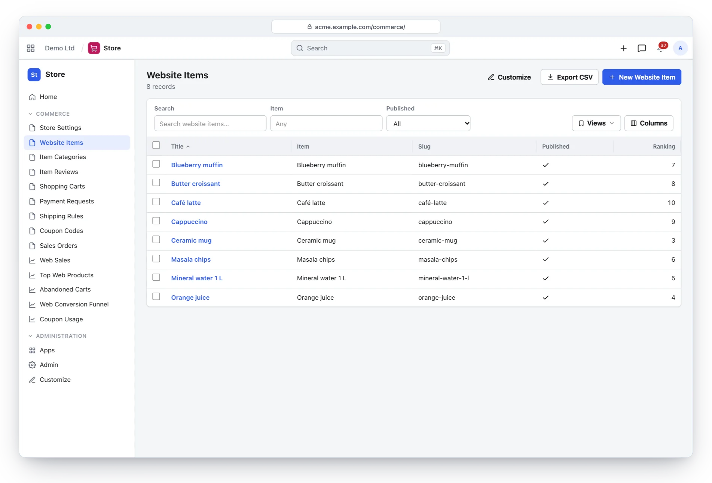
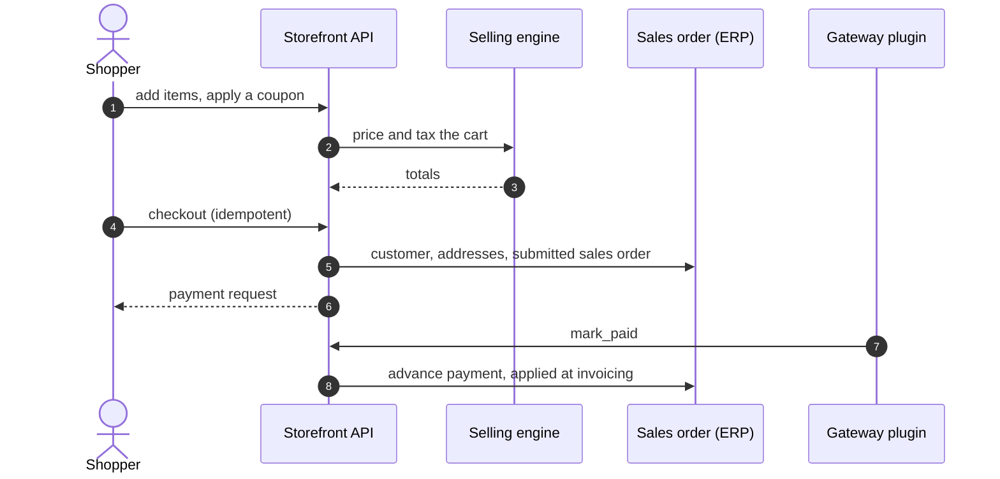
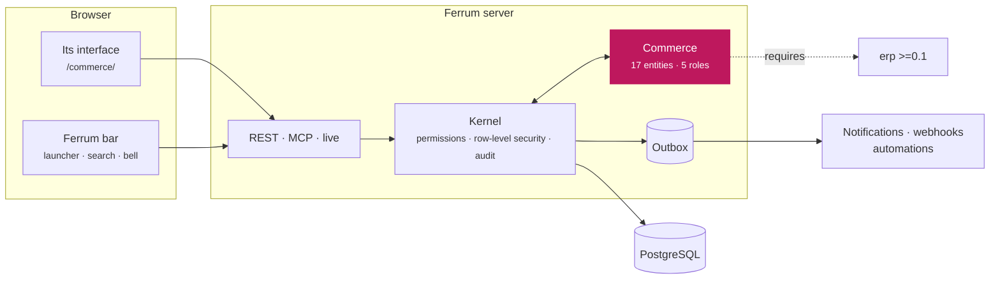
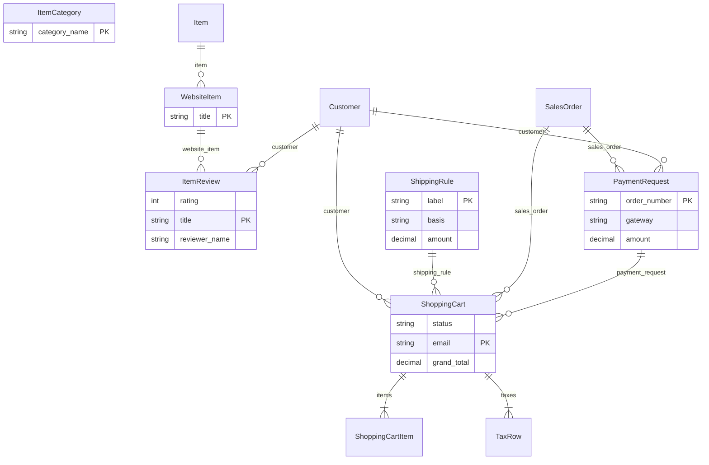

<div align="center">

<picture>
  <source media="(prefers-color-scheme: dark)" srcset="docs/assets/banner-dark.svg">
  
</picture>

[](https://github.com/CBFerrum/ferrum-app-commerce/actions/workflows/ci.yml)      

**A native app for [Ferrum](https://github.com/CBFerrum/Ferrum), the open-source, AI-first business platform.**

[Overview](#overview) · [Highlights](#highlights) · [Screenshots](#screenshots) · [How it works](#how-it-works) · [Data model](#data-model) · [Install](#install) · [Develop](#develop) · [Changelog](#changelog)

</div>

---

## Overview

Ferrum Commerce sells from the catalog, prices, taxes and stock you already keep in Ferrum.
Carts are priced and taxed by the selling engine on every change; checkout creates the customer,
addresses, a submitted sales order and a payment request in one idempotent transaction; and gateway
plugins mark payment requests paid, which books an advance applied when the order is invoiced.


| At a glance | |
|---|---|
| 📦 Version | `0.3.2` |
| 🧱 Platform | Ferrum `>=0.3.1, <0.4` |
| 🔗 Requires | erp `>=0.1` |
| 🖥️ Interface | its own, at `/commerce/` |
| 🗃️ Records | 17 entities in 1 package |
| 👥 Roles | 5: Website Manager, Sales User, Sales Manager, Accounts Manager, Accounts User |
| 📊 Reports | 5 |
| 🧪 Tests | 21 Rust tests, 1 interface test file |


## Highlights

<table>
<tr>
<td width="50%" valign="top">

### 🛍️ Catalog
Store settings, a category tree and website items with images, SEO fields and reviews.

</td>
<td width="50%" valign="top">

### 🛒 Live carts
Priced and taxed on every change; coupons with usage limits; shipping rules by amount, weight and country.

</td>
</tr>
<tr>
<td width="50%" valign="top">

### ✅ One-step checkout
Guest and portal checkout: customer, contact, addresses, sales order and payment request at once.

</td>
<td width="50%" valign="top">

### 💳 Gateway plugins
Payment requests that plugins mark paid; unpaid orders expire and release their stock.

</td>
</tr>
<tr>
<td width="50%" valign="top">

### 📦 Stock that counts orders
Open orders reserve stock, locked per item at checkout.

</td>
<td width="50%" valign="top">

### 📊 Store reports
Web sales, abandoned carts, the conversion funnel, top products and coupon usage.

</td>
</tr>
</table>

## Screenshots

<picture>
  <source media="(prefers-color-scheme: dark)" srcset="docs/assets/commerce-dark.webp">
  
</picture>

<p align="center"><sub>The store's catalog: published website items with their rank and descriptions.</sub></p>

> [!TIP]
> The screenshots follow your GitHub theme: switch between light and dark to see both.

## How it works

### Checkout



### Inside Ferrum



Everything Commerce adds is ordinary Ferrum metadata and Rust: its records get lists, forms,
search, permissions, an audit trail, exports and the REST and MCP APIs for free, so AI agents work
with them under the same rules as people.

### What it adds to Ferrum

| Where | What |
|---|---|
| 🚀 Launcher | **Store** at `/commerce/` |
| ➕ Create menu | Store item |
| ➕ Create menu | Coupon |

## Data model

The main records and how they connect (17 entities in all; `packages/` has every field).



### Roles

| Role | What it is for | Entities |
|---|---|---|
| **Website Manager** | Runs the online store - settings, catalog, categories, review moderation, shipping, coupons and payment requests. | 22 |
| **Sales User** |  | 7 |
| **Sales Manager** |  | 7 |
| **Accounts Manager** |  | 2 |
| **Accounts User** |  | 1 |

<details>
<summary><b>Reports (5)</b></summary>

- Web Sales
- Top Products
- Abandoned Carts
- Conversion Funnel
- Coupon Usage

</details>

## Install

Workspace administrators install it from **Apps** (`/store/`) in Ferrum; it ships in the
official Ferrum server image. It needs **erp** `>=0.1` installed first. Self-hosters building their own image enable the
`commerce` feature of the server. Everything it adds is also available to AI agents over
Ferrum's MCP server, within each person's permissions.

## Develop

Clone it next to the platform:

```text
work/
├── ferrum/            https://github.com/CBFerrum/Ferrum (with Ferrum-Frontend cloned into ferrum/web)
└── ferrum-app-commerce/
```

Point the platform dependencies at your checkout (this file is git-ignored):

```toml
# .cargo/config.toml
[patch."https://github.com/CBFerrum/Ferrum"]
ferrum-apps = { path = "../ferrum/crates/apps" }
ferrum-calc = { path = "../ferrum/crates/calc" }
ferrum-domain = { path = "../ferrum/crates/domain" }
ferrum-kernel = { path = "../ferrum/crates/kernel" }
ferrum-meta = { path = "../ferrum/crates/meta" }
```

The tests need PostgreSQL with an ordinary (non-superuser) role, so row-level security
applies:

```bash
createuser ferrum --pwprompt && createdb -O ferrum ferrum_commerce_test
cargo test
```

`FERRUM_COMMERCE_TEST_DATABASE_URL` overrides the database URL.


It also builds on [ferrum-app-erp](https://github.com/CBFerrum/ferrum-app-erp), and its tests on [ferrum-app-crm](https://github.com/CBFerrum/ferrum-app-crm), which Cargo takes from GitHub.
To work on them alongside this app, clone them into the same folder and add to the same file:

```toml
[patch."https://github.com/CBFerrum/ferrum-app-crm"]
ferrum-app-crm = { path = "../ferrum-app-crm" }
[patch."https://github.com/CBFerrum/ferrum-app-erp"]
ferrum-app-erp = { path = "../ferrum-app-erp" }
```


The interface lives in `ui/` and builds with Ferrum-Frontend's packages:

```bash
cd ui
npm run build      # ui/dist, checked against the size budget
npm test
```

With a development server started with `FERRUM_DEV_UI=1`, `ferrum-app dev --ui` serves the pages
from Vite behind the real bar and session, with hot reload.


### Project layout

```text
app.yaml      the manifest: id, version, requirements, what it adds to Ferrum
packages/     metadata: entities, roles, reports, workflows, print formats
src/          the app's logic in Rust: hooks, actions, endpoints, upkeep jobs
ui/           its own interface (React + Vite), built into ui/dist
tests/        integration tests against a real PostgreSQL
CHANGELOG.md  what changed in each version
```

## Changelog

| Version | Highlights |
|---|---|
| **0.3.2** | The interface starts faster: its first download holds the frame and the app's own pages, and lists, forms, reports and other apps' screens load … |
| **0.3.1** | Record cards (the bar's previews on hover, Ferrum apps-ui.md U5) stay off the web orders to deliver and the payments that did not go through … |
| **0.3.0** | The storefront on a host of its own: on a workspace host whose target is `site:commerce`, the shop's pages are at its root, rendered on the server … |
| **0.2.0** | The store's admin, an interface of its own at /commerce/, in `ui/` (built with Ferrum-Frontend's packages, `dist` committed and embedded as `UI`) … |

Every version is in [CHANGELOG.md](CHANGELOG.md).

## License

[AGPL-3.0-only](LICENSE), like the platform. Part of [Ferrum](https://github.com/CBFerrum/Ferrum) ·
[Report an issue](https://github.com/CBFerrum/ferrum-app-commerce/issues)
